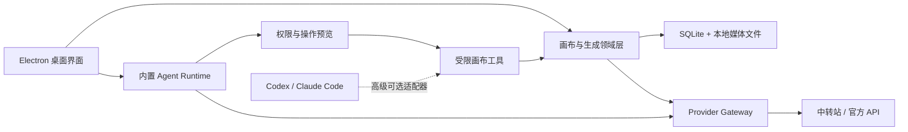

# 四季画布桌面版产品规划 v0.1

> 状态：macOS-first 第一版实施稿，Windows 构建入口保留，后续功能按本规划增量加入
> 日期：2026-08-12  
> 基础项目：[basketikun/infinite-canvas](https://github.com/basketikun/infinite-canvas)
>
> 当前产品决策：四季画布只交付 Electron 桌面应用，不提供主应用网页端、Docker 自部署版或 PWA。仓库中的 `web/` 是桌面应用的 React 渲染层；本文提到的上游浏览器数据仅用于说明历史来源和一次性导入背景。

## 本轮第一版实施边界

- 先交付 macOS Electron `.app/.dmg/.zip`，优先覆盖 Apple Silicon，并提供 Intel 与 Universal 构建入口；Windows x64 目录包/安装器继续保留。
- 画布、项目、素材、现有文本/图片/视频/音频工作流继续复用上游实现，第一版不做大规模画布重构。
- 数据先保持 localForage/IndexedDB，但桌面使用稳定 `app://local` origin；后续再迁移到 SQLite/版本化项目包和原生媒体目录。
- 中转站先建立 Provider 适配器 seam：渠道级协议预设或声明式 JSON 字段映射，模型脚本仅作为高级兜底。第一版内置 APIMart GPT-Image-2 的 JSON 提交与异步轮询，并支持声明式图片生成/参考图编辑；multipart、特殊签名、视频/音频专用接口继续使用旧脚本。
- Agent 仍沿用现有能力；本轮不把 Codex 依赖改造成内置 Agent，避免同时扩大桌面壳和 Agent 运行时的改动面。

## 1. 产品定义

### 1.1 一句话定位

一个桌面优先、本地优先、面向单人创作者的 AI 视觉创作画布：安装后即可使用自己的模型接口，在画布内完成参考收集、提示词编排、图片生成与编辑、方案对比、素材沉淀和作品导出。

### 1.2 核心用户

- 主要用户：个人创作者、AI 图片重度用户、小型内容团队中的单人工作位。
- 使用环境：Windows 和 macOS 桌面电脑。
- 默认条件：用户有一个 OpenAI-compatible 中转站或官方模型 API。
- 非首要用户：需要多人实时协作、企业权限、云端团队资产管理的组织。

### 1.3 北极星体验

1. 用户只安装 `.exe` 或 `.app/.dmg`，不安装 Docker、Node 或 Codex。
2. 首次配置只需填写名称、Base URL 和 API Key；应用自动检测模型和能力。
3. 用户从打开项目到生成第一组可比较图片，不超过 5 个关键动作。
4. 更换端口、升级应用或重新启动电脑，不会导致画布、素材、配置或会话消失。
5. 用户可在右侧和内置 Agent 对话，让它读取选中内容、创建和连接节点、发起生成；所有修改可预览、确认和撤销。

### 1.4 产品边界

- 图片创作是默认主线。
- 视频、音频、远程插件、自定义脚本、Codex/Claude Code 放入高级或实验功能。
- 不建设云账号、团队权限、实时多人协作、模板市场或完整手机端画布编辑。
- 只提供 Electron 桌面应用；不部署、不维护主应用网页端、Docker 自部署版或 PWA。

## 2. 总体技术决策

| 决策 | 结论 | 说明 |
|---|---|---|
| 桌面技术 | Electron | 最大程度复用现有 Vite/React/Chromium 行为，并能承接 Node Agent 能力。 |
| Tauri | 首版舍弃，V3 再评估 | 目前 Node Agent、MCP 和动态插件会显著增加 sidecar 或重写成本。 |
| 默认 Agent | 应用内置 Agent Runtime | 直接使用用户配置的文本/视觉模型，不依赖 Codex。 |
| Codex/MCP | 保留为高级可选项 | 供高级用户接入编码 Agent，但不成为安装和使用前提。 |
| 项目数据 | SQLite 或版本化结构化文件 | 建立明确 schema、迁移、事务和备份机制。 |
| 图片/视频/音频 | 普通本地文件 | 数据库存路径、哈希和元数据，避免长期堆积大型 IndexedDB Blob。 |
| 密钥 | macOS Keychain / Windows Credential Manager | 渲染进程只持有 secret ID，不读取明文密钥。 |
| API 请求 | Electron 主进程受控网络网关 | 解决 CORS，并统一错误、超时、重试、脱敏和权限。 |
| 自定义模型 | 内置适配器优先，声明式适配器为目标 | 任意 JavaScript 仅留在明确标注风险的开发者模式。 |
| 插件 | 内置可信插件优先 | 远程 URL 插件默认关闭，后续建立签名、权限和隔离。 |

## 3. 功能取舍总表

优先级含义：

- `P0 / V1`：首个可用桌面版必须完成。
- `P1 / V1.5`：主流程稳定后、公开分发前完成。
- `P2 / V2`：高级能力和效率增强。
- `P3 / 暂不做`：明确不进入近期范围。

### 3.1 桌面化、安装与窗口

| 项目 | 取舍 | 阶段 | 具体处理 | 验收标准 |
|---|---|---:|---|---|
| Vite/React 渲染层 | 保留 | V1 | 作为 Electron 内置界面复用现有页面和业务逻辑 | 构建产物随桌面安装包分发，不独立部署。 |
| Electron 主壳 | 新增 | V1 | 生成 macOS App/DMG/ZIP，并保留 Windows 安装包/便携版 | 不需要 Docker、Node 或命令行即可运行。 |
| Docker 主应用部署 | 移除 | V1 | 删除主应用容器、Nginx 和托管平台配置 | 仓库不存在可误认为网页版的主应用部署入口。 |
| PWA | 不提供 | V1 | 不维护应急网页入口 | 产品形态保持单一桌面入口。 |
| Tauri | 暂时舍弃 | V3 | Agent 独立协议化后再比较包体和内存收益 | 复评前不同时维护双壳。 |
| 稳定 App ID 与协议 | 新增 | V1 | 固定应用标识和 `app://` origin | 更新、深链和重启后仍能读取同一数据。 |
| 单实例运行 | 新增 | V1 | 第二次启动聚焦已有窗口 | 不出现两个进程并发写同一项目。 |
| 原生菜单和快捷键 | 新增 | V1 | 文件、编辑、视图、窗口、帮助与系统快捷键 | Windows/macOS 行为符合各自习惯。 |
| 自动更新 | 新增 | V1.5 | 签名校验、分批更新、失败回滚 | 忙碌生成任务期间不强制安装；更新前备份。 |
| macOS App Store | 暂不做 | P3 | 初期使用签名官网/GitHub 分发 | 避免远程插件和动态代码带来的审核冲突。 |
| Windows/macOS 签名 | 新增 | V1.5 | Authenticode、Developer ID、公证和 staple | 安装包及 sidecar 均能验证签名。 |
| Windows 便携模式 | 新增 | V1.5 | 可选把数据放在应用旁的独立目录 | 明确提示备份和多实例限制。 |

### 3.2 数据、项目与备份

| 项目 | 取舍 | 阶段 | 具体处理 | 验收标准 |
|---|---|---:|---|---|
| 多项目 CRUD | 保留 | V1 | 创建、重命名、复制、归档、删除和恢复 | 所有操作不丢媒体和连线。 |
| 项目首页 | 新增 | V1 | 最近项目、缩略图、置顶、搜索、导入 | 打开应用即可继续上次工作。 |
| 自动保存 | 改进 | V1 | 操作后短延迟保存并显示状态 | 异常退出后恢复最近已确认变更。 |
| localForage/IndexedDB | 迁移期保留 | V1 | 用于导入旧数据，不再作为长期唯一数据层 | 可导入现有浏览器项目和素材。 |
| 项目结构化存储 | 新增 | V1 | SQLite 或带事务的版本化数据仓库 | 每个持久化域都有 schema version。 |
| 媒体 Blob 存储 | 逐步舍弃 | V1.5 | 图片、视频、音频迁移到本地文件目录 | 10GB 素材不依赖浏览器配额；缺失文件有明确提示。 |
| 数据目录 | 新增 | V1 | 设置中可查看、打开、备份 | 路径稳定；更新不改变数据位置。 |
| 数据迁移层 | 新增 | V1 | 每次升级先备份再迁移 | 迁移中断不覆盖原数据，至少支持最近 3 个 schema。 |
| 项目便携包 | 改进 | V1 | 用 `.canvas.zip` 保存清单、节点、连线、媒体和版本 | 在干净设备离线导入后内容完整一致。 |
| 原始 JSON | 保留在高级菜单 | V2 | 仅用于排障和开发，默认剔除秘密 | 不作为普通用户主导出入口。 |
| 工作区全量备份 | 新增 | V1.5 | 项目、素材、模板和非敏感配置一次导出 | 恢复支持合并/替换，替换前自动快照。 |
| 回收站 | 新增 | V1 | 项目和素材删除先进入回收站 | 可恢复；清空前展示影响和可释放空间。 |
| 命名快照/版本历史 | 新增 | V1.5 | 自动快照 + 用户命名快照 | 至少保留 10 个自动快照；恢复前可预览并另存。 |
| WebDAV | 保留并改进 | V1.5 | 定位为备份优先、同步次之 | 测试连接；删除 tombstone；冲突可选本地、远端或另存。 |
| 云账号与云存储 | 舍弃 | P3 | 不建设登录墙和自有云后端 | 离线可查看和编辑所有本地项目。 |

### 3.3 画布交互

| 项目 | 取舍 | 阶段 | 具体处理 | 验收标准 |
|---|---|---:|---|---|
| 无限平移/缩放 | 保留并打磨 | V1 | 光标中心缩放、一键适配全部/选区 | 200 个混合节点下无明显卡顿或跳动。 |
| 框选和多选 | 保留并标准化 | V1 | 明确选择模式；`Space`/中键临时平移 | 文本输入时快捷键不误触。 |
| 小地图 | 保留但降噪 | V1.5 | 小画布隐藏，大画布显示或建议开启 | 不遮挡高频操作。 |
| 网格/点阵/空白背景 | 保留 | V1 | 作为项目偏好保存 | 切换可撤销且不改变内容位置。 |
| 撤销/重做 | 保留并强化 | V1 | 普通操作至少 100 步；Agent 使用事务日志 | 删除、移动、连接、插入生成结果均可恢复。 |
| 连线和上下游高亮 | 保留并简化 | V1 | 连接点按需出现，突出直接关系 | 不兼容连接拒绝并解释原因。 |
| 快速创建 | 新增 | V1 | 双击空白或 `/` 打开插入菜单 | 两步内创建文本、图片、生成或分组。 |
| 分组/画框 | 新增 | V1.5 | 命名、整体移动、折叠、按画框导出 | 节点加入/移出逻辑可预测。 |
| 自动布局 | 新增 | V2 | 横向流程、纵向流程、网格、等距、对齐 | 可预览且一次撤销。 |
| 命令面板 | 新增 | V1.5 | `Cmd/Ctrl+K` 搜索全部动作 | 可纯键盘创建节点、切项目、打开设置和导出。 |
| 快捷键自定义 | 暂缓 | V2 | 先稳定默认键位，后续支持重映射 | 有冲突检测、恢复默认和方案导入导出。 |
| 触屏完整编辑 | 舍弃 | P3 | 不为手机复制复杂节点操作 | 桌面交互不因移动端妥协。 |

### 3.4 节点、生成与结果管理

| 项目 | 取舍 | 阶段 | 具体处理 | 验收标准 |
|---|---|---:|---|---|
| 文本/提示词节点 | 保留 | V1 | 编辑、AI 改写、版本分支、`@` 引用 | 改写不覆盖原文，可沿连线查看版本。 |
| 图片节点 | 保留并强化 | V1 | 拖放、粘贴、文件导入、URL 导入、下载、替换 | 保持原比例，大图异步加载不阻塞画布。 |
| 生成配置节点 | 改进 | V1 | 默认在右侧属性栏使用简单模式，可转高级节点 | 第一次生图只需提示词、比例、数量。 |
| 多图结果组 | 保留并打磨 | V1 | 紧凑叠组、流式出现、展开、主图、单张重试 | 用户两步内完成对比、收藏或设主图。 |
| 生成元数据 | 保留并强化 | V1 | 提示词、模型、参数、引用、时间、费用和来源 | 任一结果可一键查看配方和复刻流程。 |
| `@` 引用 | 保留并增强 | V1 | 缩略图、类型、顺序和失效提示 | 实际发送顺序与编辑器展示一致。 |
| 图片基础编辑 | 保留 | V1 | 裁剪、旋转、翻转、透明背景等已稳定能力 | 修改保留原图或明确覆盖选择。 |
| 高级图片编辑器 | 暂缓 | V2 | 蒙版、局部重绘、图层等独立规划 | 不阻塞首版图片生成闭环。 |
| 视频/音频 | 默认隐藏 | V2 | 放入实验功能，复用统一任务系统 | 关闭时主界面不出现相关参数。 |
| 生成任务队列 | 新增 | V1.5 | 并发、排队、取消、重试、优先级 | 可连续提交任务，不必等待前一个完成。 |
| 失败分类 | 改进 | V1 | 区分网络、鉴权、参数、供应商、下载和本地存储 | 错误定位到节点并提供可执行解决办法。 |
| 输出导出 | 保留并完善 | V1 | 原图、PNG/JPEG/PDF、透明背景、1x/2x、选区/画框 | 导出前可预览边界和文件数量。 |

### 3.5 素材、提示词和模板

| 项目 | 取舍 | 阶段 | 具体处理 | 验收标准 |
|---|---|---:|---|---|
| 我的素材 | 保留并升级 | V1 | 图片、文本为默认；收藏、标签、集合、搜索 | 从画布保存再插回不超过两步。 |
| 视频/音频素材 | 保留数据兼容，默认隐藏 | V2 | 启用实验功能后显示 | 不干扰默认图片素材界面。 |
| 去重 | 新增 | V1.5 | 文件哈希检测和复用提示 | 相同文件不无提示重复占空间。 |
| 来源追踪 | 新增 | V1.5 | 显示来源项目、节点、生成配方和使用位置 | 删除前列出受影响项目。 |
| 个人提示词库 | 改进为优先入口 | V1 | 任一文本节点可保存和打标签 | 搜索后两步内插入当前项目。 |
| 公共 GitHub 提示词源 | 保留为可选 | V2 | 默认只留精选源，自定义 URL 放高级区 | 远端不可用不影响个人库。 |
| 内置工作流模板 | 新增 | V1 | 参考板、风格探索、商品图、社媒变体、故事板 | 模板到第一组结果不超过 3 分钟。 |
| 选区保存为模板 | 新增 | V1.5 | 可选择嵌入引用素材或留占位符 | 再插入后节点 ID、连接和参数合法。 |
| 模板市场 | 舍弃 | P3 | 不建设作者、评分、审核和兼容体系 | 首期只有内置与个人模板。 |

### 3.6 中转站与模型配置

| 项目 | 取舍 | 阶段 | 具体处理 | 验收标准 |
|---|---|---:|---|---|
| 多渠道能力 | 保留 | V1 | 主界面只显示当前渠道；多渠道放高级设置 | 可新增、测试、停用、排序和设置默认。 |
| 首次配置向导 | 新增 | V1 | 名称 → Base URL/API Key → 测试与选默认模型 | 3 分钟内完成配置；错误不用看堆栈。 |
| 连接测试 | 新增/改进 | V1 | 分别检测网络、TLS、鉴权、模型接口和生成接口 | 显示精确原因及建议。 |
| 自动拉取模型 | 改进 | V1 | 成功则拉取，失败允许手填并解释 | 不因缺少 `/models` 阻止可用端点。 |
| 模型能力检测 | 新增 | V1 | 检测文本、视觉、工具调用、JSON、流式、图像/视频能力 | 模型列表显示清晰能力标签。 |
| 参数动态匹配 | 新增 | V1 | 根据模型显示支持的比例、尺寸、数量、透明背景等 | 无效组合不能提交。 |
| 收藏和隐藏模型 | 新增 | V1 | 只把常用模型显示在节点选择器 | 选择器不再被全部模型淹没。 |
| 全局默认 + 节点覆盖 | 保留并明确 | V1 | 默认继承，节点可覆盖并一键恢复 | 覆盖状态清晰，复制节点不引用失效渠道。 |
| 供应商适配器 | 改进 | V1 | 内置 OpenAI-compatible 及少量明确协议模板 | 尺寸、响应、轮询和错误统一转换。 |
| 自定义 JavaScript | 隐藏并限制 | V2 | 仅开发者模式，明确“完全可信代码”风险 | 默认关闭；可校验、超时、恢复模板。 |
| 声明式适配器 | 新增 | V1 | 用 schema 配置 URL、方法、字段映射、轮询和结果路径 | 主流非标准图片接口无需执行任意代码。 |
| 请求检查器 | 新增 | V1.5 | 展示脱敏后的请求、响应、耗时和错误 | 不显示 API Key、密码和完整私密媒体。 |
| Key 明文浏览器存储 | 舍弃 | V1.5 | 迁入系统密钥库 | Renderer、日志、数据库和导出包中无明文。 |
| 配置导出带秘密 | 舍弃 | V1 | 默认排除密钥和 WebDAV 密码 | 如需包含必须二次确认并加密。 |

### 3.7 内置 Agent 与 Codex

| 项目 | 取舍 | 阶段 | 具体处理 | 验收标准 |
|---|---|---:|---|---|
| 右侧 Agent 面板 | 保留并去 Codex 化 | V1 | 供应商无关的对话、附件、进度、停止、重试和历史 | 不安装 Codex 也可完整使用。 |
| 默认 Agent 后端 | 新增 | V1 | 使用已配置中转站文本/视觉模型 | 支持工具调用的模型可直接操作画布。 |
| 内置 Agent Runtime | 新增 | V1 | 隔离进程运行对话循环、工具调用和恢复 | 不监听本地端口，不需 URL/Token。 |
| Canvas Agent 概念 | 保留核心协议 | V1 | 复用画布状态和 `canvas_apply_ops` 思路 | 工具操作均经 schema 校验和策略引擎。 |
| `npx canvas-agent` | 舍弃为默认流程 | V1 | 不要求命令行或 Node | 安装桌面应用后无需额外步骤。 |
| Local URL/Token 配置 | 舍弃为默认流程 | V1 | 桌面内部使用受限 IPC | 普通设置中不出现端口和 token。 |
| Codex CLI 强依赖 | 舍弃 | V1 | Codex 仅为高级 Adapter | 内置 Agent 的所有基本工具独立可用。 |
| Codex/MCP 外部入口 | 保留并改进 | V2 | 随应用打包，可选启用，无需 npm 环境 | 能从 Codex/Claude Code 定位当前画布。 |
| 选中/上游上下文 | 保留并改进 | V1 | 选中优先、上游一层、全画布摘要、按需取详情 | 每轮不发送整个项目；界面说明发送了什么。 |
| Chat-only 降级 | 新增 | V1 | 不会工具调用的模型仍能正常对话和建议 | 不从自由文本猜测命令。 |
| 操作预览 | 新增 | V1 | 新增/移动/连接用幽灵预览；批量删除强制确认 | 应用前展示影响对象，拒绝后无状态变化。 |
| 事务式撤销 | 新增 | V1 | 每轮 Agent 产生一个 ActionSet 和逆向操作 | 可逐步撤销或整轮撤销。 |
| 付费生成确认 | 新增 | V1 | 展示模型、参数、数量和可得费用信息 | 未确认不发起外部生成。 |
| Agent 读操作 | 保留 | V1 | 读取上下文、搜索节点/素材、查询生成状态 | 默认自动执行。 |
| Agent 画布写操作 | 改进 | V1 | 创建、更新、连接、布局先预览 | 所有操作带版本检查和幂等 ID。 |
| Shell/终端 | 舍弃 | V1 | 内置 Agent 永不开放 | 模型无法执行任意命令。 |
| 任意文件访问 | 舍弃 | V1 | 仅用户选取的文件和应用数据目录可用 | 路径穿越和未授权路径访问被拒绝。 |
| 任意网络工具 | 舍弃 | V1 | 只通过已配置 Provider 和受限素材导入 | 防止扫描内网或泄露数据。 |
| 会话保存 | 改进 | V1 | 默认随项目保存，另有少量全局会话 | 重启后能继续，删除项目时明确处理会话。 |
| Ollama/LM Studio | 新增 | V2 | 本地模型适配器 | 无云 API 也能 Chat；工具能力按检测结果开放。 |
| 多 Agent/Skills | 暂缓 | V3 | 等单 Agent 稳定后再平台化 | 不进入首版界面和数据模型。 |

### 3.8 Agent 首版工具清单

| 工具 | 用途 | 默认权限 |
|---|---|---|
| `canvas_get_context` | 读取选中、视口、上游或摘要 | 自动 |
| `canvas_find_nodes` | 按标题、内容、类型和状态搜索 | 自动 |
| `canvas_get_node_details` | 读取少量指定节点详情 | 自动 |
| `canvas_focus` | 选中、聚焦和调整视口 | 自动 |
| `canvas_apply_ops` | 新建、修改、移动、连接、断开、删除和分组 | 预览后执行；破坏性操作强制确认 |
| `canvas_arrange` | 对齐、等距、网格、横向/纵向布局 | 预览后执行 |
| `generation_get_capabilities` | 查询可用模型和参数 | 自动 |
| `generation_create_flow` | 创建提示词、配置和引用连线 | 预览后执行 |
| `generation_run` | 发起文字、图片、视频或音频生成 | 单独费用确认 |
| `generation_get_status` | 查询任务状态和失败原因 | 自动 |
| `prompts_search` | 搜索个人/公共提示词 | 自动 |
| `assets_search` | 搜索本地素材 | 自动 |
| `assets_save` | 保存文本或结果到素材库 | 预览或按用户偏好自动 |

### 3.9 插件、安全与扩展

| 项目 | 取舍 | 阶段 | 具体处理 | 验收标准 |
|---|---|---:|---|---|
| 内置官方节点插件 | 保留 | V1 | 作为可信随应用代码发布 | 现有常用节点通过回归测试。 |
| URL 远程插件 | 默认隐藏/关闭 | V1 | 放开发者实验区，安装显示来源、版本、权限和风险 | 默认体验不依赖远程插件。 |
| 插件原生权限 | 舍弃 | V1 | 不提供通用 fs、shell、网络、更新或 Agent IPC | 恶意插件不能发现或调用原生能力。 |
| 插件哈希/签名 | 新增 | V1.5 | 固定版本和内容校验，声明最低 App 版本 | 内容变化需重新授权。 |
| 真正插件沙箱 | 新增 | V3 | iframe/Worker 消息协议替代直接在 React 树执行 | 插件崩溃或恶意行为不影响主应用数据。 |
| Agent 工具插件 | 舍弃首版 | V3 | 权限系统成熟后才开放签名工具 | V1/V2 远程插件不能注册 Agent 工具。 |
| Electron Renderer Node 权限 | 舍弃 | V1 | `nodeIntegration=false`、`contextIsolation=true`、`sandbox=true` | 页面内无 `require`/`process`，IPC 只接受白名单消息。 |
| 关闭 Web 安全/TLS | 舍弃 | V1 | 使用主进程网络网关解决兼容问题 | 证书错误不被静默忽略。 |

### 3.10 信息架构与界面

| 项目 | 取舍 | 阶段 | 具体处理 | 验收标准 |
|---|---|---:|---|---|
| 一级导航 | 改进 | V1 | 收敛为项目、画布、素材、模板、设置 | 一级入口不超过 5 个。 |
| 画布布局 | 改进 | V1 | 左侧创建/素材，顶部画布工具，右侧属性/Agent，中心画布 | 同一参数只有一个主编辑位置。 |
| 创作者/高级模式 | 新增 | V1 | 默认隐藏插件、脚本、协议细节和调试信息 | 切换后状态持久化，关闭不损坏数据。 |
| 状态中心 | 新增 | V1 | 统一展示保存、同步、生成、Agent 后台任务 | 可查看、取消和重试；错误定位到节点。 |
| 首次引导 | 新增 | V1 | 配置向导 + 可跳过的示例项目 | 新用户 3 分钟内完成接口测试和首次生成。 |
| 显式帮助页堆叠 | 舍弃 | V1 | 通过模板、默认值、错误提示和上下文控件解决 | 主流程不依赖阅读长教程。 |
| 无障碍与键盘 | 改进 | V1.5 | 焦点顺序、可见焦点、对比度、菜单键盘操作 | 主要非画布控件可纯键盘操作。 |

### 3.11 日志、测试与发布质量

| 项目 | 取舍 | 阶段 | 具体处理 | 验收标准 |
|---|---|---:|---|---|
| 数据迁移测试 | 新增 | V1 | N-1 到 N、异常中断、备份恢复、导入校验 | 不发生静默丢数据。 |
| 桌面 E2E | 新增 | V1 | Windows/macOS 覆盖创建、保存、重启、拖放、剪贴板、生成、Agent、导出 | 每次发布前通过关键路径。 |
| 权限边界测试 | 新增 | V1 | 非法 IPC、路径穿越、恶意插件、错误 token/origin | 所有越权请求明确失败。 |
| 容量和故障测试 | 新增 | V1.5 | 大项目、磁盘满、断网、崩溃和任务取消 | 重启后状态一致，错误可恢复。 |
| 统一结构化日志 | 新增 | V1 | 主进程、Renderer、Agent、Provider 使用关联 ID | 可定位一轮生成或对话的完整链路。 |
| 日志脱敏和轮转 | 新增/改进 | V1 | 隐藏 token、key、密码和完整 data URL | 日志大小有上限且自动轮转。 |
| 诊断包 | 新增 | V1.5 | 用户确认后导出版本、日志、插件清单和存储统计 | 默认不含画布内容、密钥和个人媒体。 |
| 崩溃遥测 | 暂缓 | V3 | 默认关闭，明确同意后才上传 | 用户能检查上传字段。 |

## 4. 明确保留的上游价值

1. 无限画布的平移、缩放、选择、拖拽、连线和小地图基础。
2. 多项目以及节点、连线、视口、背景的项目结构。
3. 文本、图片、生成配置和媒体节点的核心数据模型。
4. 文生图、参考图编辑、文本改写和批量结果流程。
5. 上游引用、`@` 引用和生成结果的配方元数据。
6. 多渠道和 OpenAI-compatible 接口生态。
7. 提示词库、我的素材、画布/选区导出能力。
8. `canvas_apply_ops` 一类结构化画布操作思想。
9. Agent 读取选择、上游和画布状态的上下文思想。
10. MIT 许可下可复用的代码；分发时保留版权和许可证声明。

## 5. 明确舍弃或不做的内容

1. Docker 作为普通用户唯一或默认安装方式。
2. 依赖不断变化的浏览器 URL/Origin 保存核心数据。
3. 必须安装 Codex CLI、Node 或手工运行 `npx` 才能使用 Agent。
4. 普通用户手填 Agent Local URL、Token 和 Origin。
5. Renderer 获得 Node、通用文件系统、Shell、任意 IPC 或任意网络能力。
6. 通过关闭 CORS、`webSecurity` 或 TLS 校验解决接口兼容。
7. 默认执行携带 API Key 的任意 JavaScript 模型脚本。
8. 默认显示 URL 远程插件安装、JSON 和协议级参数。
9. 首版建设视频/音频主工作台、多 Agent、Skills 平台和插件市场。
10. 云账号、团队空间、实时协作、评论、权限和在线光标。
11. 完整手机端节点编辑、连线和桌面功能同构。
12. App Store 首发、工作流模板市场和自有云服务。

## 6. 重点改进项

1. 部署改成安装即用的 Windows/macOS 桌面应用。
2. 浏览器缓存改成有 schema、迁移、备份和恢复的数据层。
3. 中转站配置改成向导、自动模型发现、能力检测和动态参数。
4. 模型脚本从默认必需降为开发者高级能力，并逐步改成声明式适配器。
5. Agent 从 Codex 专属改成供应商无关，使用用户自己的模型。
6. Agent 写操作增加 schema 校验、权限策略、差异预览、确认和事务撤销。
7. 生成配置改成简单/高级两层，普通用户默认只见常用参数。
8. 多图结果改成更紧凑的比较、主图、收藏和单张重试流程。
9. 素材库增加去重、来源、使用关系、回收站和存储管理。
10. 项目增加首页、缩略图、自动保存状态、快照和便携项目包。
11. 画布交互向 Figma/Excalidraw 的一致键鼠规则靠拢。
12. UI 收敛成“左创建、中画布、右属性/Agent”，高级能力默认隐藏。

## 7. 新增能力清单

1. Electron 桌面壳、原生菜单、单实例和跨平台安装包。
2. SQLite/版本化数据仓库、本地媒体目录和系统密钥库。
3. 数据迁移、自动备份、回收站、命名快照和全量恢复。
4. `.canvas.zip` 便携项目格式和旧浏览器数据迁移器。
5. Provider Gateway、模型能力检测、收藏模型和请求检查器。
6. 内置 Agent Runtime、供应商无关事件协议和 Chat-only 降级。
7. Agent 权限策略、操作预览、事务日志、费用确认和会话持久化。
8. 项目首页、模板中心、命令面板、统一任务/保存状态中心。
9. 生成任务队列、并发控制、取消、重试和失败分类。
10. 个人提示词库、素材去重、来源追踪、集合和使用位置。
11. 分组/画框、选区保存模板、按画框导出和智能布局。
12. 安装包签名、自动更新、诊断包和跨平台 E2E。

## 8. 分阶段路线图

### Phase 0：基线与风险收敛（建议 1-2 周）

目标：冻结一个可验证的上游版本，先确认不会在桌面化过程中丢失现有能力。

- Fork 并锁定上游 commit，建立 `upstream` 同步策略。
- 建立当前核心流程回归清单和样例项目。
- 拆分约 3,000 行的高耦合画布页面边界：领域操作、存储、生成、Agent、视图。
- 定义项目 schema、媒体清单、ActionSet、Provider、Agent 事件协议。
- 建立 Windows/macOS CI 基础。

退出条件：核心流程有自动或可重复的基线测试；数据和 IPC 契约经过评审。

### Phase 1：桌面壳与可靠数据（建议 3-5 周）

目标：获得不依赖 Docker、数据不会随 URL 丢失的内部桌面版。

- Electron 安全壳、稳定 App ID、单实例、原生菜单。
- 应用数据目录、项目仓库、媒体目录、自动保存和恢复。
- 旧 localForage/IndexedDB 数据导入。
- `.canvas.zip` 项目导入导出、schema 校验和升级前备份。
- 项目首页、回收站和统一保存状态。
- Windows/macOS 未签名内部安装包。

退出条件：重启、升级测试和换机器导入后，项目、媒体、视口和配置均完整。

### Phase 2：模型配置与生成主流程（建议 3-4 周）

目标：普通用户无需写脚本即可配置中转站并完成图片工作流。

- 三步 Provider 向导、连接测试、模型拉取和手填降级。
- 模型能力检测、收藏/隐藏和默认模型映射。
- 动态参数 schema、尺寸规范化和统一错误模型。
- 简单/高级生成界面、多图结果组和配方复刻。
- 个人提示词库、基础素材库升级和 5 个内置模板。
- 主进程网络网关的首版，解决常见 CORS 和资源下载问题。

退出条件：至少覆盖 3 类常见 OpenAI-compatible 中转；错误能区分网络、鉴权、模型和参数问题。

### Phase 3：内置 Agent（建议 4-6 周）

目标：没有 Codex 的用户也能在侧边栏让 Agent 理解并操作画布。

- 供应商无关的 Agent Sidebar 和事件协议。
- 内置 Agent Runtime、模型能力分级和 Chat-only 降级。
- 选中/上游/摘要上下文构建。
- 首版受限工具注册表。
- ActionSet 校验、画布版本检查、幂等、操作预览和整轮撤销。
- 生成费用确认、会话随项目保存和日志脱敏。

退出条件：只配置一个支持工具调用的中转模型，即可完成“理解选择 → 创建提示词/生成节点 → 连接 → 发起生图 → 撤销”。

### Phase 4：公开 Beta 质量（建议 3-5 周）

目标：达到可以给非开发者安装测试的质量。

- API Key/WebDAV 密钥迁入系统密钥库。
- 自动快照、全量备份、WebDAV 冲突与 tombstone。
- 生成任务队列、素材去重、来源追踪和存储管理。
- 远程插件默认关闭、哈希/版本校验。
- 诊断包、容量/故障测试、跨平台 E2E。
- macOS/Windows 签名、公证和自动更新。

退出条件：干净机器安装、带旧数据升级、异常断电/断网和磁盘满测试均有确定结果，不发生静默丢数据或密钥泄露。

### Phase 5：高级能力（按需，建议 4-8 周）

目标：在不破坏默认简单体验的前提下服务重度用户。

- Ollama/LM Studio。
- Codex/Claude Code 可选 Adapter 和外部 MCP 入口。
- 生成任务高级调度、视频/音频实验功能。
- 画框、智能布局、跨项目搜索、选区模板。
- 声明式模型适配器和隔离脚本运行时。
- 更严格的插件沙箱和签名工具扩展。

退出条件：所有高级功能关闭时，V1 默认体验和数据格式不受影响。

## 9. 建议里程碑与计划表

以下按 1 名熟悉 TypeScript/Electron 的全职开发者估算，属于规划级范围，不是承诺工期；若同时处理上游同步或 UI 重构，应预留约 25% 缓冲。

| 里程碑 | 累计时间 | 主要交付 | 用户可见结果 |
|---|---:|---|---|
| M0 基线冻结 | 第 1-2 周 | 契约、测试基线、上游同步策略 | 暂无新功能，但降低后续返工风险。 |
| M1 内部桌面 Alpha | 第 3-7 周 | Electron、项目数据、媒体、迁移、项目包 | 双击安装，重启不丢画布。 |
| M2 图片工作台 Alpha | 第 8-11 周 | Provider 向导、能力检测、生成简化、模板、素材 | 不写模型脚本即可开始常用生图。 |
| M3 内置 Agent Alpha | 第 12-17 周 | 内置对话、画布工具、预览、撤销、费用确认 | 不装 Codex 也能让侧边 Agent 操作画布。 |
| M4 公开 Beta | 第 18-22 周 | 密钥库、任务队列、备份同步、签名更新、诊断 | 可交给普通用户长期试用。 |
| M5 1.0 候选 | 第 23-26 周 | 缺陷收敛、性能、迁移矩阵、文档 | 达到个人长期主力工具标准。 |

若只做你自己先用的版本，可以把 M1-M3 压缩为约 10-14 周：暂缓签名、自动更新、WebDAV 冲突、插件平台和完整素材治理，但不能省略数据迁移、备份、Agent 权限边界和密钥导出保护。

## 10. 竞品借鉴清单

| 产品 | 借鉴什么 | 不照搬什么 |
|---|---|---|
| PureRef | 拖入参考图、极低干扰、快速排布、可选置顶 | 不只做静态参考板。 |
| Obsidian Canvas | 本地文件、数据可掌控、嵌入、画布长期保存 | 不复制知识库和 Markdown 管理全套。 |
| Eagle | 素材标签、集合、去重、来源和大规模搜索 | 不先做独立 DAM 产品。 |
| Figma/FigJam | 一致的平移缩放选择、属性面板、画框、快捷键 | 不做多人协作、组织权限和设计系统。 |
| Excalidraw/tldraw | 即开即用、可预测快捷键、文件可携带、扩展性 | 不把自由手绘作为核心。 |
| Krea Canvas | 图片优先的 AI 画布、参考关系、低门槛生成 | 不绑定单一云模型服务。 |
| ComfyUI | 工作流可复现、参数/引用溯源、流程模板 | 默认不暴露复杂图和大量工程节点。 |
| Invoke | 模型管理、任务队列、图库元数据和统一 AI 工作台 | 不在首版承担本地大模型下载管理。 |
| Canva/Milanote | 项目首页、模板起步、素材复用和清晰入口 | 不做模板市场和全品类设计套件。 |
| Cherry Studio/OpenRouter | Provider 向导、模型发现、能力标签和多渠道管理 | 不让供应商配置成为主界面。 |

## 11. 风险与防线

| 风险 | 影响 | 防线 |
|---|---|---|
| 上游仍快速变化且声明不保证数据兼容 | 更新可能破坏长期项目 | 锁定 fork；建立 schema、迁移和上游 cherry-pick 策略。 |
| 画布页面高度耦合 | 桌面、存储和 Agent 改动容易互相影响 | Phase 0 先抽离领域操作和契约，不做无关大重写。 |
| 远程插件和 `new Function` 获取密钥 | 桌面化后可能扩大为本机权限风险 | Renderer 无 Node；默认关闭；密钥在主进程；声明式适配器。 |
| Provider 号称 OpenAI-compatible 但实际差异很大 | 模型拉取、尺寸、响应和工具调用反复失败 | 能力探测、协议模板、参数 schema、脱敏检查器和降级。 |
| Agent 模型工具调用不可靠 | 错误修改画布或破坏内容 | 严格 schema、最多两次修复、预览确认、版本检查、事务撤销。 |
| 大量媒体导致数据膨胀 | 启动慢、备份大、磁盘满 | 文件化媒体、哈希去重、懒加载、存储统计、可回收缓存。 |
| 自动更新引发数据损坏 | 核心信任崩溃 | 先完成迁移/备份/回滚，再启用自动更新。 |
| 桌面跨平台差异 | 剪贴板、拖放、快捷键和 WebView 行为不一致 | Electron 固定 Chromium，Windows/macOS E2E 和真实安装升级测试。 |

## 12. 成功指标

- 安装成功率：无需额外运行环境完成启动的测试用户 ≥ 95%。
- 首次配置成功率：有有效 API 的用户首次完成连接测试 ≥ 90%。
- 首次价值时间：从安装完成到第一组图片结果中位数 ≤ 5 分钟。
- 数据可靠性：发布测试矩阵中静默数据丢失为 0。
- 任务可恢复：应用崩溃/断网后，已确认画布操作恢复率 100%。
- Agent 可控性：测试集内未确认的写操作和付费生成执行数为 0。
- Provider 可解释性：常见失败均归入明确类别，不用原始堆栈作为用户提示。
- 默认界面复杂度：一级导航 ≤ 5，一级创建动作 ≤ 6，高级能力默认不出现。

## 13. 当前建议默认值（待确认）

1. 默认产品路线：图片工作台优先，Agent 为同一 V1 主线中的第三阶段，而不是独立产品。
2. 默认 Agent：使用用户已配置的中转站文本/视觉模型；Codex 仅为高级可选后端。
3. 默认权限：读取、搜索和聚焦自动；所有画布写入先预览；删除/批量覆盖强制确认；付费生成单独确认。
4. 默认数据：项目会话跟随项目保存；密钥进入系统钥匙串；配置导出不含秘密。
5. 默认功能：图片、文本、素材和模板开启；视频、音频、远程插件、自定义脚本和本地模型关闭。
6. 默认发布：先内部未签名 Alpha，再做签名公开 Beta；不首发 App Store。
7. 默认兼容：可一次性导入上游浏览器历史数据和最近 3 个本产品 schema；不提供持续运行的 Web 版或共享实时数据库。

## 14. 进入实施前需要最终拍板的 7 项

1. 是否确认“图片工作台优先”，视频/音频放 V2 实验区。
2. 是否确认 Electron 为 Windows/macOS 首版桌面壳。
3. 是否确认内置 Agent 默认使用中转站模型，Codex 降为高级选项。
4. 是否接受 Agent 所有画布写操作默认先预览，付费生成每次确认。
5. 是否需要 V1 就支持 Windows 便携版，还是只做标准安装器。
6. 是否把 WebDAV 放到公开 Beta，而不是首个自用 Alpha。
7. 是否需要继续保留和上游频繁同步；若是，必须建立独立改造层，避免直接长期修改上游核心页面。

## 15. 研究依据与证据边界

本规划基于项目 README、功能文档、节点/快捷键文档、Canvas Agent 文档、公开 GitHub Issues 和公开产品模式。公开问题已验证以下高信号痛点：Docker/NAS 数据无法落盘、升级后历史数据风险、中转模型拉取失败、模型尺寸差异、WebDAV/CORS、远程图片 CORS 和 Codex 素材导入失败。

主要来源：

- [项目 README](https://github.com/basketikun/infinite-canvas/blob/main/README.md)
- [功能介绍](https://github.com/basketikun/infinite-canvas/blob/main/docs/content/docs/overview/features.mdx)
- [节点操作手册](https://github.com/basketikun/infinite-canvas/blob/main/docs/content/docs/canvas/canvas-node-manual.mdx)
- [快捷键](https://github.com/basketikun/infinite-canvas/blob/main/docs/content/docs/canvas/canvas-shortcuts.mdx)
- [Canvas Agent](https://github.com/basketikun/infinite-canvas/blob/main/canvas-agent/README.md)
- [Issue #159：Docker/NAS 持久化](https://github.com/basketikun/infinite-canvas/issues/159)
- [Issue #63：中转站模型加载](https://github.com/basketikun/infinite-canvas/issues/63)
- [Issue #23：模型尺寸兼容](https://github.com/basketikun/infinite-canvas/issues/23)
- [Issue #98：WebDAV/CORS](https://github.com/basketikun/infinite-canvas/issues/98)
- [Issue #117：Codex 网络素材](https://github.com/basketikun/infinite-canvas/issues/117)
- [Issue #143：生成任务队列](https://github.com/basketikun/infinite-canvas/issues/143)
- [Issue #149：远程结果图片 CORS](https://github.com/basketikun/infinite-canvas/issues/149)

本轮没有完成在线 Demo 的现场交互和无障碍审计，因此画布 UI 细节属于基于代码、文档和公开截图的产品建议；进入视觉设计前仍需做一次实际运行审计。
